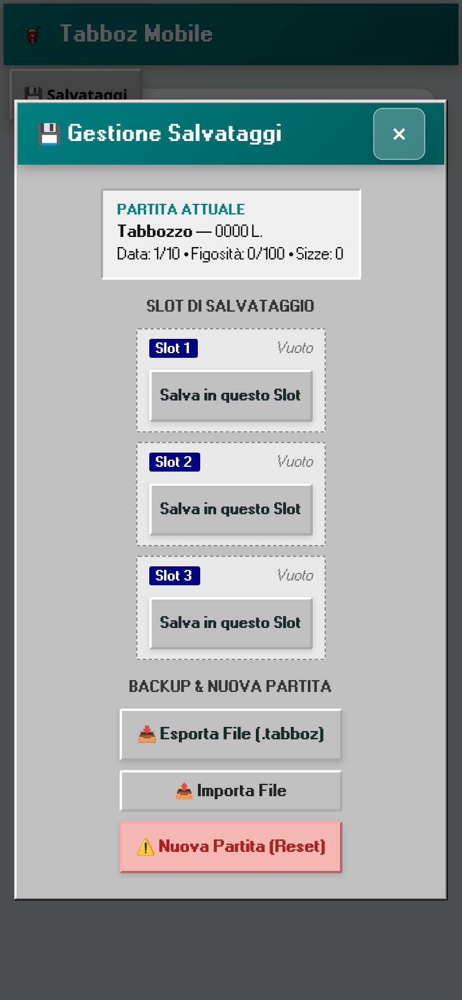
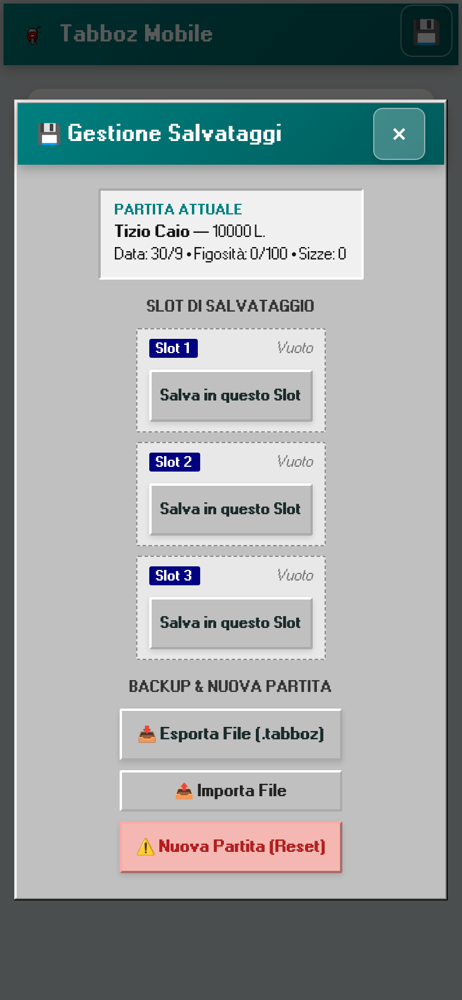
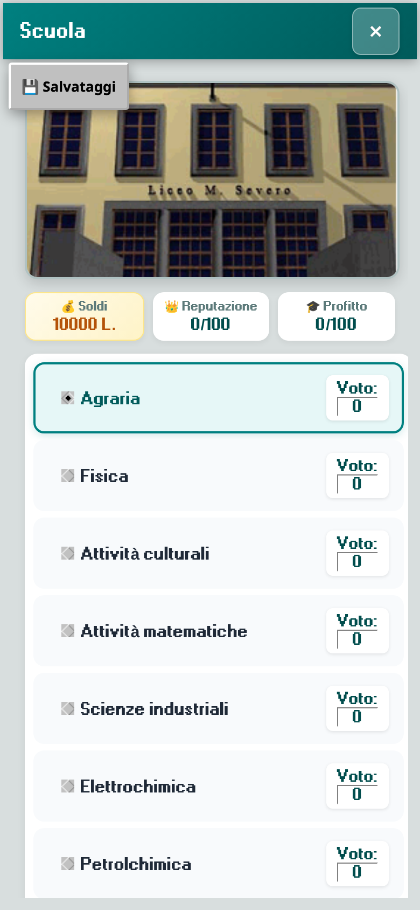
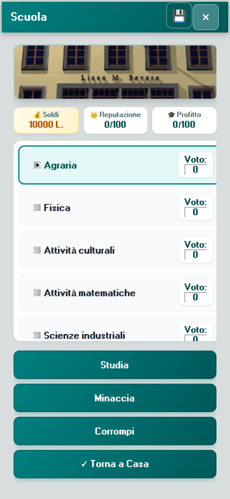
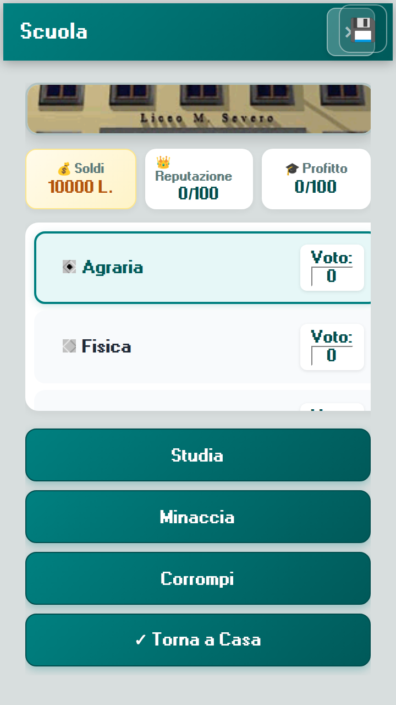
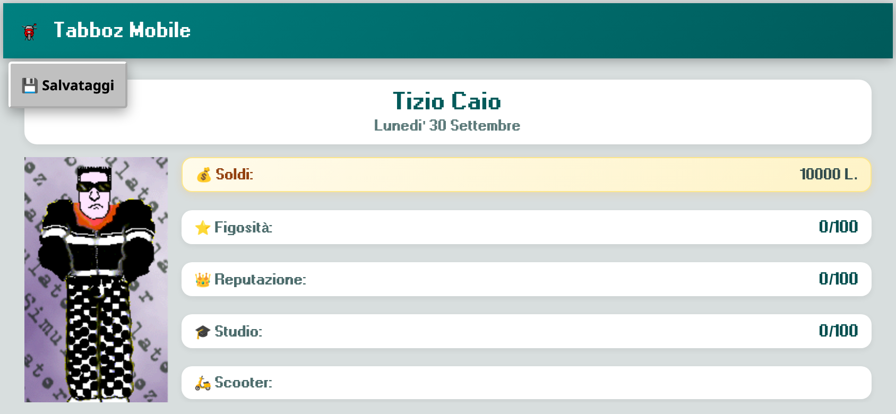
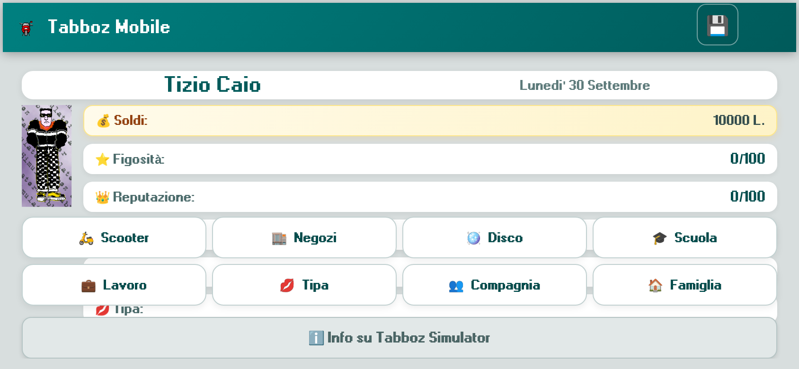

# Tabboz Mobile — play bug report

Played in Chrome (touch, mobile) against `python3 server.py` at `/mobile/`.

Viewports: 390×844 (portrait), 844×390 (landscape), 360×640 (small Android).

Screenshots live in [`mobile/e2e/screenshots/`](mobile/e2e/screenshots/).

## Fixed

### 1. Save panel invents a character and stores an empty slot

- **Severity:** high
- **Steps:** Start a new game. Before doing anything else, tap Salvataggi.
- **Expected:** The panel shows the live game: Tizio Caio, 10000 L., 30 Settembre. Saving a slot and reloading keeps that game.
- **Actual:** The panel showed `Tabbozzo — 0000 L.` and `Data: 1/10` while the dashboard showed Tizio Caio / 10000 L. / Lunedi' 30 Settembre. "Salva in questo Slot" wrote `{"registry":{}}`. Loading that slot cannot restore a game. The engine only writes `localStorage` inside `SalvaTutto` (random events, exit, configuration OK), so a fresh game had no registry yet.
- **Fix:** Before the panel opens (and once the dashboard is up), the shell asks the engine to save by confirming Configuration (dialog 14) off-screen. That dialog's OK calls `SalvaTutto` and does not change difficulty or sound. Empty registries are refused. Money is formatted like the game (`10` → `10000 L.`, zero stays `0 L.`).
- **Before:** 
- **After:** 

### 2. Scuola actions sit below the fold

- **Severity:** medium
- **Steps:** Open Scuola on a 390×844 phone (also 360×640).
- **Expected:** Studia, Minaccia, Corrompi, and Torna a Casa are tappable without hunting.
- **Actual:** The nine subject cards pushed those buttons to about y=1000. The list scrolls, but a first look shows only subjects.
- **Fix:** The subject list scrolls inside the screen. The action buttons stay on screen.
- **Before:** 
- **After:**  and on 360×640 

### 3. Landscape dashboard hides the main menu; save button covers the name

- **Severity:** medium
- **Steps:** Rotate to 844×390. Look at the dashboard. Also compare the Salvataggi chip with the name on portrait.
- **Expected:** Scooter, Negozi, Disco, Scuola, Lavoro, Tipa, Compagnia, and Famiglia are on screen. Salvataggi does not cover the name or Chiudi.
- **Actual:** The portrait image is fixed at 300px, so the menu started around y=440 on a 390px-tall screen. The floating "Salvataggi" chip overlapped the name.
- **Fix:** Short viewports use a smaller portrait and a 4-column menu. Salvataggi is a 44px icon in the title bar, to the left of Chiudi.
- **Before:** 
- **After:** 

## Found, not fixed

### 4. Personal Information and Configuration are unreachable, and the generic layout is scrambled

- **Severity:** medium
- **Steps:** There is no dashboard control for them. The original menu (`Personal Information` = command 139, `Configuration` = command 140) is `display: none`. Posting those commands opens the dialogs.
- **Expected:** A player can change name and difficulty, with labels next to the right values.
- **Actual:** Dialog 11 text comes out in source order (`6260`, `P. 1`, `S. A`, `Nome`, `Cognome`, `13 Luglio`, `Studente`, `Celibe` mixed together). Dialog 14 is the original English skill list ("Choose Skill level", "I'm too young be a tabbozzo") dumped into one column. The OK control is easy to miss, especially in landscape.
- **Why not fixed:** The normal play path never opens these screens. Showing them with the generic layout would be worse than leaving the hidden menu hidden. A real mobile layout for both dialogs is a separate screen, not a small fix.

## Played and working

- Splash → dashboard (Tizio Caio, 10000 L., Lunedi' 30 Settembre).
- Scuola: Studia raises Agraria and profit. Corrompi asks Sì/No; with only 10000 L. the professor refuses ("non hai abbastanza soldi").
- Disco: picking Hollywood updates the description and the price. Entering on the starting Monday shows the closure notice.
- Bar Tabacchi: 24 packs, tap selects a brand (Philip Morris Super Light, nicotine line), Compra is available.
- Famiglia: asking for 100.000 lire shows the original refusal.
- Negozi, Lavoro, Tipa, Compagnia, About: screens open and Torna returns to the dashboard.
- Reload after the engine flush keeps the name, money, and date.
- No page errors or failed image loads on these paths.

## Regression checks

```bash
node mobile/js/test.js
python3 server.py
node mobile/e2e/bugs.js
```

`bugs.js` needs Playwright and Chrome. It covers the save panel, a non-empty slot, Scuola buttons on screen, the save icon vs. name/Chiudi, and the landscape menu.
